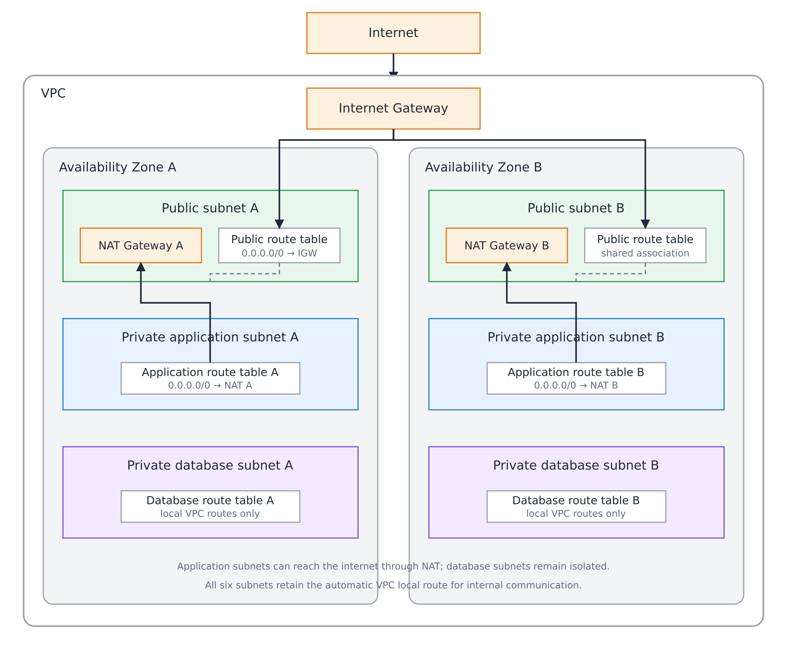

# AWS Production Infrastructure Foundation

## Business Case 1

NovaPay a fintech organization deploys its first containerized production application on AWS. In achieving this I had to first setup its netwoking infrastructure using  infrastructure as code configuration files to easily manage and deploy its application.

## Architecture - Phase 1

## Infrastructure

VPC/subnets/routing/NAT/IG

## Design Decisions

#### Why public/private/DB tiers exist:

1. Public subnets for internet facing infrastructure
2. Private subnets for internal application - ECS workloads and Database (RDS)

#### Why two AZs are used:

1. Reduces single point of failure
2. Higher reliability and resilience(fault tolerance)

#### Why modules are used:

1. Reusable across multiple environments
2. Testability
3. Easily version controlled

#### Why for_each was selected:

1. Reduces code redundancy and duplicity
2. Facilitate data manipulation easily

#### Why remote state is used:

1. Version control
2. CICD operation
3. Teams can easily access, share and modify state where necessary

## Repository Structure

terraform-aws-network

	|-----architecture

	|-----bootstrap-backend

	|-----environments

		|-----dev

	|-----modules

		|-----network

	|-----gitignore

	|-----readme

## Prerequisites

1. Install terraform
2. clone repo
3. setup virtual env
4. Run terraform init

## Security Considerations

Public subnet
↓
can route to Internet Gateway

Private application subnet
↓
does NOT route directly to Internet Gateway
↓
NAT provides outbound connectivity

Private database subnet
↓
does NOT have direct Internet routing

## Assets:

[vpc-assets](architecture/images)

## Business case 2

Implement security controls based on two principles:

1. Network least privilege: Only explicitly authorized communication should be permitted.
2. IAM least privilege: AWS identities should receive only the permissions required to perform their responsibilities.

## Technical requirements 

| ID      | Requirement                           | Acceptance Criteria                                    |
| ------- | ------------------------------------- | ------------------------------------------------------ |
| SEC-001 | ALB security group                    | Allow HTTPS from the internet                          |
| SEC-002 | Application security group            | Allow TCP 8000 only from the ALB                       |
| SEC-003 | Database security group               | Allow PostgreSQL 5432 only from the application        |
| SEC-004 | Restrict unnecessary outbound traffic | Explicitly define required egress                      |
| SEC-005 | ECS task execution role               | Allow ECS to pull images and publish logs              |
| SEC-006 | ECS application task role             | Establish a separate least-privilege identity          |
| SEC-007 | IAM trust policies                    | Allow only the appropriate AWS service to assume roles |
| SEC-008 | Terraform reusability                 | Implement reusable security and IAM modules            |
| SEC-009 | Validation                            | Verify policies, network rules, and Terraform plans    |
| SEC-010 | Documentation                         | Record architecture, decisions, and troubleshooting    |

## Architecture - Phase 2

